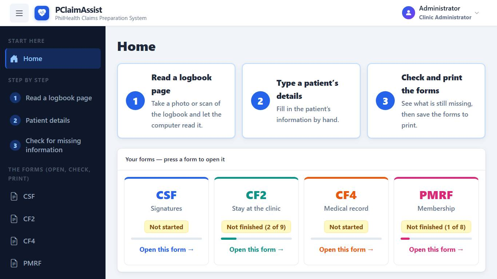
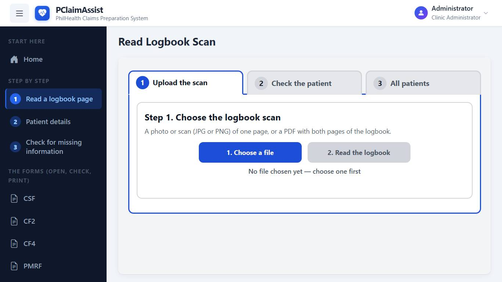
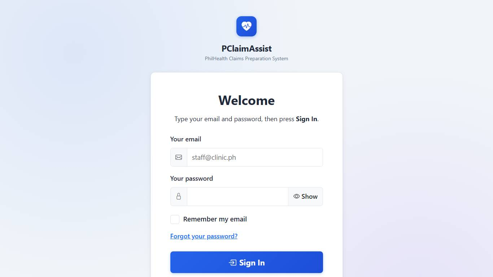
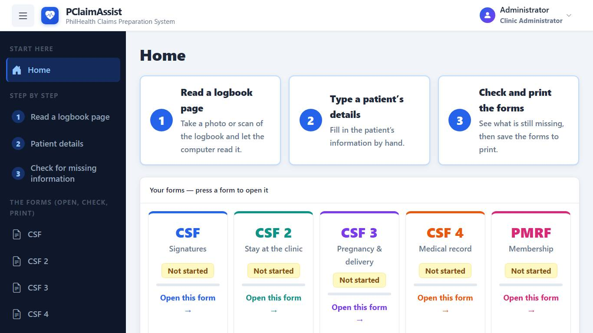
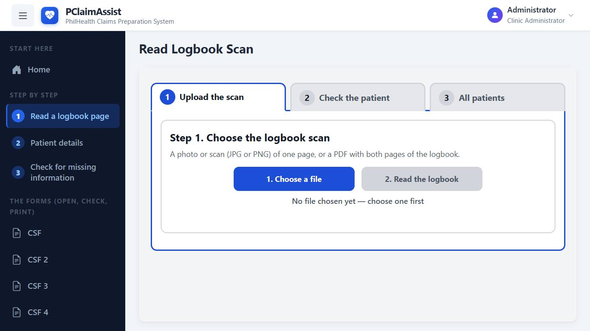
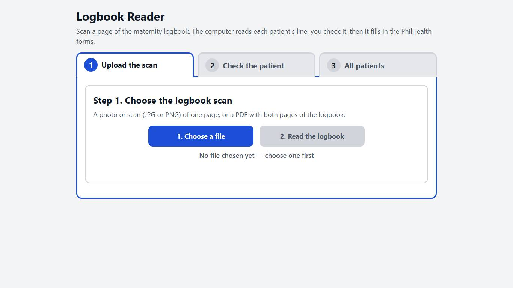
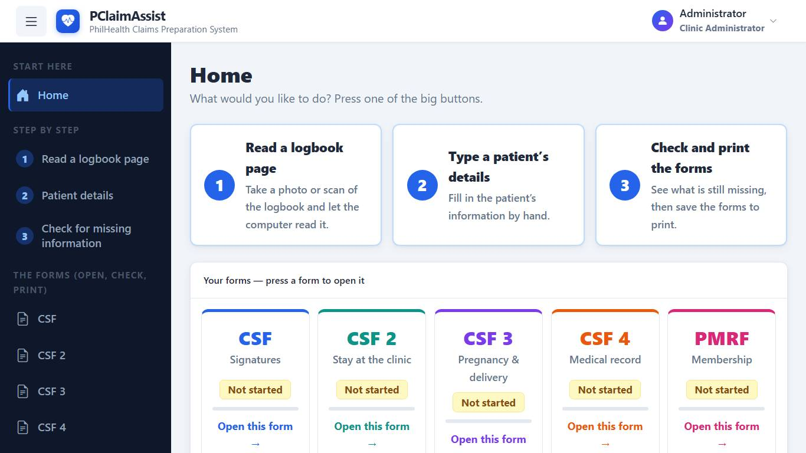
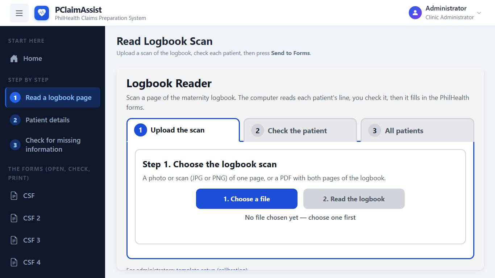
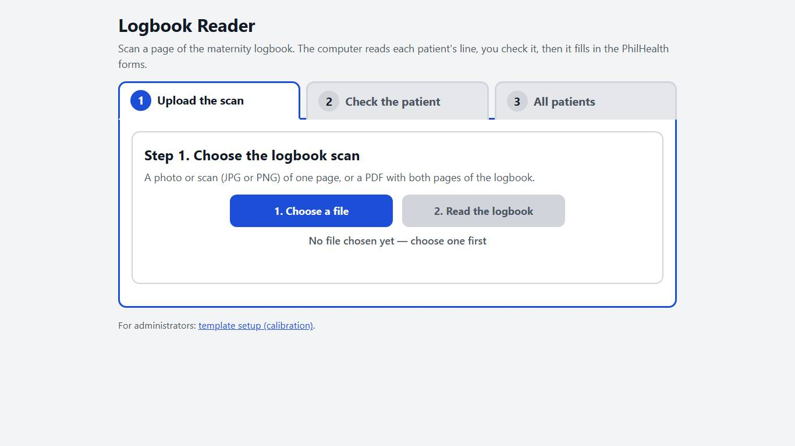

# PClaimAssist – Change Log

A record of every change to PClaimAssist, from the first commit to now,
newest first. Each entry gives the date, the author, and the git commit, so
you can see the exact code with `git show <commit>`.

Related documents:
- [SETUP.md](SETUP.md): how to install and run the system
- [CHAPTER_DETAILS.md](CHAPTER_DETAILS.md): codebase facts for the thesis chapters
- [Ocr_module/benchmarks/README.md](Ocr_module/benchmarks/README.md): the PaddleOCR vs Tesseract comparison tool

---

## 2026-10-25 22:54: UI update (reigh)

- Changed: style.css, index.html, app.js, login.html, ocr.html

**Login page**

**Main app (dashboard)**

**Read Logbook Scan page**

## 2026-10-25 22:53: UI update (reigh)

- Changed: style.css, index.html, login.html, ocr.html

**Login page**

**Main app (dashboard)**

**Read Logbook Scan page**

## 2026-10-25 00:37: UI update (reigh)

- Changed: style.css, index.html, app.js, sidebar.js, validation-rules.js, login.html, ocr.html

**Login page**

**Main app (dashboard)**

**Read Logbook Scan page**

## Not yet committed (2026-10-24)

**Steadier, clearer forms** (client feedback: boxes moved while typing, the
parts ran together, the preview was hard to read) (`css/style.css`, `js/app.js`, `js/pdf/pdf-overlay.js`)
- Nothing moves while typing. The cause was the warning line inserted
  under a box when a rule was broken and removed when fixed (about 40px
  each time). A broken rule now puts a small icon on the box's label
  instead; its message shows when the icon is pointed at or focused, and
  the box keeps its red/amber outline. Checked by typing into the first
  dozen boxes of every form: no box moved.
- The summary line above the boxes is always two lines tall, so finishing
  the form no longer pulls everything up; the panel keeps room for its
  scroll bar.
- Each stage of a form has its own colour (band, heading and a light
  wash: blue, teal, violet, orange, green, rose in turn); a part marked
  "Not needed" turns grey. The "Not needed" tick stays on its heading's
  line.
- Patient details: each section of a tab (Patient, Member, Address,
  Contact, ...) has the same colour band and heading as the forms' parts.
  Typing there moves nothing either.
- Check for missing information: a form's missing boxes come first, each
  with its own "Fix this"; the filled ones shrink to small green chips
  under "Filled in" instead of a long stack of rows. Each form's header
  reads the same way - code, full name (Claim Signature Form, Claim Form
  2/4, Member registration), a progress bar in the form's colour (green
  when done) and the count on the right.
- Preview size: "−  Fit  +" on every preview (Fit, 125%-200%). One
  setting for all four forms, kept for the next visit; the page is
  re-drawn sharp and scrolls sideways when wider than the panel.

**CF2 is back** (`index.html`, `js/app.js`, `js/validation-rules.js`, `js/pdf/*`, `js/sidebar.js`, `css/style.css`, `forms/CF2.pdf`, `Ocr_module/philhealth/*`, `Ocr_module/claims_store.py`, `Ocr_module/routes/claims_routes.py`)
- Restored from before `58a4a3a`: the page, dashboard card, sidebar entry,
  export chip, checker fields, links to the CSF (professionals, the
  clinic's representative, who signs for the patient), and the server-side
  CF2 export and readiness check.
- Its PDF map is moved onto the exporter's baseline, the same correction
  CSF and PMRF got in `58a4a3a` (6pt - 0.13em higher per field).
- The CF2 vs CF4 diagnosis check is now IC-09 (IC-08 was reused since).

**Printed alignment** (`js/pdf/overlays/*.js`, `js/pdf/pdf-overlay.js`, `js/app.js`)
- Measured from the blank PDFs: on the CSF and CF2 every typed value now
  sits 1.5pt above the rule under it (drawn lines and underscore rows),
  so the heights match across the form.
- Names are centred: name parts, signature names and designations on
  their line (CSF, CF2), or in their table cell (CF4 columns, PMRF).
- CF2's dates, times and accreditation digits go between the ticks of
  their bracket cells; its tick marks are centred in their squares.
- CSF: every digit (PINs, PEN, dates, accreditation numbers) and tick box
  is set to the exact square printed for it, centred both ways. On the
  preview the red "missing" boxes now cover those squares instead of
  overlapping their neighbours or sitting in a corner.
- A value too long for a one-line box is printed smaller instead of
  wrapping into the labels below (CF4 street, PMRF subdivision).
- CSF Item 9 prints a name only over the line of whoever signs: the
  representative's line was always printing the patient's name.

**CF4 is the February 2020 edition** (`forms/CF4.pdf`, `js/pdf/overlays/cf4.js`, `js/pdf/pdf-overlay.js`, `js/app.js`, `index.html`)
- The blank comes from the clinic's own copy with every filled-in value
  removed: the clinic's details and the (hidden) patient data. The 2018
  file is in git history.
- Every CF4 position was rebuilt for the new layout: tick boxes found by
  their printed labels, digits by their boxes, text by the ruled lines
  and the baselines the clinic's copy used. Names and address parts are
  centred in their columns.
- New: Height (cm) and Weight (kg) beside the vital signs.
- Course in the ward (15 lines) and drugs (7, two lines each) are
  written as small lines inside the form's one course box and three
  drug rows.
- Fixed: 9.b / 10.b times never printed (their boxes read a value that
  nothing set).
- On the preview, course-in-the-ward and drug lines show red only once
  they are open in "Type the details here" ("+" opens the next one); a
  drug's "(cont.)" line and the "additional sheet(s)" ticks never do.

**Health care professionals, one at a time** (CSF Part IV, CF2 Item 10)
- Each professional (1, 2, 3) has its own "Not needed" tick in place of
  one for the whole part, so the unused rows can be left out while the
  attending midwife's row is still asked for.

**"The patient is the member" untick clears** - the member's boxes it
filled (name, birthday, sex, PIN, relationship) are emptied when it is
unticked on Patient details or the CSF. A loaded claim is never cleared.

**CF2 procedure lines**
- Each repetitive procedure (8.a) has its own dates box, shown once it is
  ticked, printed on the line beside it (they were all one "Procedure
  details" box printing over "b. For Z-Benefit Package"). Unticking hides
  the box and leaves its line blank. Text in an older claim's single box
  still prints on the first ticked procedure's line.
- A long diagnosis in 7 (a or b) is laid onto its three ruled lines at
  full size instead of squeezed onto the first.

**CF2 preview and III-B**
- The clinic PAN and the professionals' accreditation digits sit in the
  middle of their squares (they hugged the left edge).
- A long diagnosis is shrunk on the preview, as on the print, to fit its
  three lines instead of running over row "b.".
- New: 8.f "For Essential Newborn Care" - the nine items (immediate
  drying, timely cord clamping, weighing, BCG, hepatitis B, early
  skin-to-skin contact, eye prophylaxis, vitamin K, non-separation for
  early breastfeeding) are ticked in their printed boxes. They show in
  "Type the details here" once Essential Newborn Care is ticked, and are
  cleared if it is unticked.
- 6. Admission Diagnosis sat on the border with section 7; it is now in
  the middle of its space, and a long one wraps to a second line that
  still clears the border.
- III-B: "Patient is Incapacitated" / "Other Reasons" were mapped onto
  the Patient/Representative squares, so a reason printed in the wrong
  place. They are on their own squares now, and Patient/Representative
  is printed from the CSF Part III answer (the same consent).
- Not shown as missing when they are not wanted: "Others, Specify" and
  "Other reasons" until that option is chosen (CSF too), the co-pay
  amount until "With co-pay" is ticked, and the representative's
  relationship and reason while the patient signs.

**Red boxes on the form preview** (`js/pdf/pdf-overlay.js`, `js/app.js`, `css/style.css`)
- A part marked "Not needed" (or a signer row not in use, or a PIN with
  "No PhilHealth") no longer shows red on the preview, and neither do the
  other options of a tick-one row once one is chosen.
- Pointing at a red box says what it is (part and box); clicking it goes
  to the box where it is typed, like "Fix this" did.
- The "On this form" list above the boxes is now one line: the counts,
  the hint, and a link to the checker for rules that are not one box.

**Page turner shows only that page's boxes**
- CF2's special procedures, TB-DOTS and newborn care boxes sat outside
  both page groups, so they showed on page 2 as well; they are page 1's.
- PMRF had no page groups at all, so both pages showed everything. Page 2
  now shows only Updating/Amendment and the member's signature.
- The forms are named CF2 and CF4 everywhere (were "CSF 2" / "CSF 4").

**Series numbers removed** from the CSF and CF4 (entry boxes, printed
digit boxes and state). CF2 comes back without one.

**Clinic Details** (`database/migrations/009_clinic_provider_rep.sql` - apply it)
- New: the authorized HCI representative and designation (CSF Part V),
  and the attending health care professional's name and PAN (CF4 Part VII,
  also CSF Part III / CF2 professional 1).
- The clinic PAN is 12 digits (was 9), checked on the page and the server.

**Fewer things typed twice**
- Certification of Member (CSF Item 9): only the rows for whoever signs
  (member or representative) are shown and asked for; switching clears
  the other signer's rows so they are not printed.
- Age (CF4) is worked out from the birthday as of admission; EDD from the
  LMP (+280 days). A value typed over either is kept.
- PMRF "Same as Permanent Address" now copies the address, zip included,
  and locks the mailing boxes.
- The attending midwife (name, PAN, date signed) is linked across CSF
  Part III row 1, CF2 and CF4; the member's signature date across CSF and
  PMRF. CF2's HCI address preview includes the building number and zip.

## Not yet committed (2026-10-22)

**PhilHealth PIN red while empty, and "No PhilHealth"** (`PClaimAssist/index.html`, `js/app.js`, `js/validation-rules.js`)
- The PIN's three boxes (js/pin-input.js) now turn red while the PIN is
  empty, like every other needed box: the red marks skipped the hidden
  input behind them, so the boxes never showed it.
- A "No PhilHealth" tick beside the patient's PIN and beside the member's
  (account holder's) PIN on Patient details: that PIN is then not asked
  for (not red, not counted as missing, "not needed" in the checker - for
  the member on the CSF, CF4 and PMRF) and its boxes are greyed out. What
  was typed is kept. The PIN-length rule IF-01 skips a member with no
  PhilHealth. While the patient is the member, the member's tick follows
  the patient's and is locked (the member's PIN boxes are now locked then
  too). Kept with the patient on this page only - no database column.
- Fixed: the member's PIN stayed red after ticking "No PhilHealth" in easy
  mode - js/easy.js marks needed boxes on its own (by the label's red
  asterisk) and now skips a PIN whose tick is on (`pinNotAsked`), and no
  longer counts the ticks themselves as boxes "to type". The patient's PIN
  label has the red asterisk too now, so easy mode asks for it the same way.
  Checked in a browser: each tick clears its PIN's red and takes one off
  the "to type" count; unticking brings both back.

**Whole-row picture without the red box** (`Ocr_module/templates/review.html`)
- Clicking the scan in the logbook review opens the whole row as scanned:
  no red box around the cell and no dimming around it. It still opens
  scrolled to the box being checked.

**Final diagnosis: "Same as the admission diagnosis" tick** (`PClaimAssist/index.html`, `js/app.js`, `Ocr_module/templates/review.html`)
- Forms (Patient details): a tick above Discharge / Final Diagnosis copies
  the admission diagnosis and keeps following it, also when the delivery
  message is put in; the CSF and CF4 copies follow as for typing. Off by
  default; a loaded claim starts ticked when the two are already the same.
- Logbook review: the same tick under the final diagnosis box ("Same as the
  reason for admission"), following the reason for admission as it is
  typed or put in with "Use the delivery message".

**Went home at least a day after the delivery** (`philhealth/review_fields.py`, `templates/review.html`, `PClaimAssist/js/validation-rules.js`, `js/app.js`, `index.html`)
- Logbook review: a "Went home" date on or before the delivery date is a
  problem to fix before saving (it was only a warning when it was before
  the delivery). The went-home box's quick button is now "Day after
  delivery" instead of "Same day as admitted".
- Forms: new rule IC-08 (block): the discharge date must be at least one
  day after the delivery date. The "Same day as admitted" tick on Date
  Discharged is now "The day after delivery" (on by default): the date
  follows the delivery date; untick it to type a later date. A claim loaded
  with its own discharge date keeps it - the tick stays on only when that
  date is the day after delivery.

**"Cabantian" a starter address word** (`database/migrations/008_address_cabantian.sql`)
- The clinic's barangay joins "Davao" and "City" as a starter word for the
  address column, so a close misreading in an unsure address cell
  ("CABANTlAN", "Cabantain") is suggested as Cabantian. Only a suggestion:
  the field stays "please check", sure readings are untouched, and other
  barangays are left as read. Already learned from reviews here (its counts
  are kept); the migration makes sure a fresh install has it too.
- Two common words read as one are split (`Ocr_module/paddle_assist.py`):
  "CASANTANDAUAO" -> "CABANTIAN DAVAO", when both halves (4+ letters each)
  are close to common words - addresses and diagnoses only, never names.
  A short word starting with C right after "Davao" ("CY", "CTY") is
  suggested as "City". "CASANTANDAUAO CY" -> "CABANTIAN DAVAO CITY".
- Words joined by a period, comma or semicolon are matched apart
  ("CABANNAN.DAVAOC" -> "CABANTIAN, DAVAO CITY"); "Davao" with City run on
  ("DAVAOC", "DAUAOCY") becomes "Davao City"; and the word right before
  "Davao"/"DC" - the barangay - matches more loosely ("CARSANTAN",
  "CANANNAN" -> "Cabantian"). Addresses and diagnoses only; dates and times
  are never split on punctuation.
- These fixes are put in the box, not only hinted: an unsure, not yet
  checked field gets them when the patient is opened
  (`paddle_assist.fix_saved_reading`, `routes/review_routes.py`), so scans
  read before a fix was added get it too. Fields PaddleOCR was sure of, and
  checked patients, are left as they are.

**OCR output in capitals** (`Ocr_module/logbook_pipeline.py`, `routes/review_routes.py`, `philhealth/review_fields.py`, `templates/review.html`, `PClaimAssist/js/app.js`)
- Names and text columns (address, reason for admission, final diagnosis,
  and any other text column) come out of the logbook reading in capitals:
  the value the pipeline passes on, the review boxes, "Computer read" and
  the AI's reading, the patient list, what is saved, and the claim. Typing
  in the review turns into capitals, as on the PClaimAssist forms. Scans
  read before this get capitals when opened, and a claim opened with "Send
  to Forms" is put in capitals as it loads.
- Dates, times and case numbers are left as read: their parsing turns OCR
  look-alike letters into digits by case ("l" is 1, "b" is 6, "B" is 8).
- `raw_text` is still stored exactly as PaddleOCR read it, for the accuracy
  statistics and the AI's learning. A value that differs from the reading
  only in capitals no longer counts as an edit.
- One rule decides which columns: `review_fields.in_capitals()`.
- Names keep only letters, spaces, hyphens and apostrophes
  (`review_fields.clean_name_part()`): "Jr." becomes "JR", "Ma. Liza"
  becomes "MA LIZA", and "!" and other symbols are taken out, both in what
  the scan suggests and in what is saved. Digits the OCR put in a name are
  dropped from the suggestion; a typed digit is still flagged to fix.

**Each PIN asked once on the CSF; form-header status badges update** (`PClaimAssist/js/pin-input.js`, `index.html`, `js/app.js`)
- The CSF's member and patient PIN each showed two rows of boxes: its own
  per-digit row and a second set added by the PIN script. The PIN script now
  skips a PIN that already has its own boxes.
- The "Not started / Ready to print" badge in each form's header shared its
  id with the dashboard's, so only the dashboard one ever changed. Both
  update now.

**Each form says what is missing and which rules are broken** (`PClaimAssist/js/app.js`, `css/style.css`)
- At the top of each form's "Type the details here" panel (CSF, CSF 4,
  PMRF), a notice lists what "Check for missing information" finds for that
  form alone, updating as boxes are filled: the boxes still empty, and the
  rules broken for it (red: must be fixed, amber: to check, each with its
  rule code), each with "Fix this". Rules about the whole claim are counted
  on one line that leads to the checker. With nothing left it turns green,
  "Nothing missing on this form". It can be folded away, and stays folded.

**CF4 signs & symptoms in the form's own order** (`PClaimAssist/index.html`, `css/style.css`)
- The 36 tick boxes were in three columns read across, so the first row was
  "Altered mental sensorium, Abdominal cramp/pain, Anorexia" while the
  printed CF4's first row is "Altered mental sensorium, Diarrhea,
  Hematemesis, Palpitations". They are now the form's 4 columns of 9, read
  down each column; in a narrower panel the same columns go two by two
  (1-2, then 3-4). The Pain site and Other symptoms boxes sit under their
  tick, as on paper.

**"Fix this" always lands where you can type** (`PClaimAssist/js/app.js`)
- "Fix this" (on each form's notice and on "Check for missing information")
  did nothing for boxes kept on a Patient details tab that was not open -
  the dates, civil status, address, member type: the section opened but
  the box stayed out of sight. It now opens the tab (or turns the form's
  page) first, and lands on choice buttons too. Date Discharged, while
  "same day as admitted" is ticked, lands on that tick. Checked on all 28
  "Fix this" buttons of an empty patient.

**No "grey boxes" note on the forms** (`PClaimAssist/js/app.js`, `css/style.css`)
- The note "The grey boxes were filled in from Patient details. To change
  them, open Patient details." is gone from CSF, CSF 4 and PMRF. The grey
  boxes are still locked, and each still says where it is changed when
  pointed at.

**Patient details: the "Next step" bar only says where to go**
  (`PClaimAssist/js/easy.js`)
- Its "Go there" button (and "Check for missing information" once done) is
  gone; moving between parts is done with each part's Back / Next part
  buttons.

**Save the forms one by one or together** (`PClaimAssist/index.html`, `js/pdf/pdf-overlay.js`, `js/app.js`, `css/style.css`)
- "Check for missing information" always has the save card now: tick the
  forms (CSF, CSF 4, PMRF - all ticked to start) and press the one button,
  whose words follow the ticks: "Save all 3 forms as one PDF", "Save CSF +
  CSF 4 as one PDF", or "Save CSF 4 as PDF" for one form on its own (one
  file prints in one go). With nothing ticked it reads "Tick a form to save".
  The card is green with "Everything is filled in" when nothing is
  missing, and amber with "Some boxes are still empty" otherwise - a form
  saved then prints with those boxes blank. (Before, the one button only
  appeared once everything was filled in.)

**Red marks show at once, and only where something is missing** (`PClaimAssist/js/app.js`, `js/pdf/pdf-overlay.js`, `css/style.css`)
- Some empty boxes only turned red after something else was clicked: the
  CSF's per-digit rows (PIN, PEN, dates - 112 boxes), a form's second page
  after "Next page", and a course-in-the-ward line shown with "+". The red
  marks are now worked out again whenever such boxes appear.
- In the form preview every printable spot had a red dashed box, filled or
  not. Now only the spots still empty are boxed in red; a filled one shows
  just its text, so the red left on the preview is what is missing.

**Logbook Reader: case number year, and the usual admission wording** (`Ocr_module/templates/review.html`, `philhealth/review_fields.py`)
- The case number box starts with the year ("2026-"), so only the logbook's
  number is typed; a number read without its year gets it ("6140" ->
  "2026-6140"). The year is the admission's, if read (a page from December
  gets last year's), else this year. Left at just "2026-", it counts as
  empty.
- "Use the delivery message" under Reason for admission: the same sentence
  with blanks as on Patient details, started from what the computer read
  in the box ("PUFT 38 2/7 WKS ... G3P2 (2102)" fills those blanks), so
  only the rest is typed. Patient details' template now also starts from
  the text already in its box.

**The delivery message: the doctors' usual admission diagnosis, as a template** (`PClaimAssist/index.html`, `js/app.js`)
- A claim is only made for a delivery, so the admitting diagnosis is nearly
  always the same sentence. "Use the delivery message" under Admission
  Diagnosis (Patient details) opens it with only its blanks to fill:
  PUFT [39] [3]/7 wks AOG delivered via NSVD to a live term baby [boy]
  [AGA] w/ AS of [8] & [9]; G[2]P[2] ([2][0][0][2]).
- The blanks are filled from what is already typed where possible: weeks
  and days of AOG from the LMP to the delivery (or admission) date, the
  baby's sex, G, P, the term/preterm/abortion/living count and the APGAR
  score. Red blanks must be filled before "Put this in Admission
  Diagnosis"; it asks before replacing text already there, and fills any of
  those fields that were still empty. CF4's Admitting Diagnosis prints it.
- Replacing text already in the box is asked in the page ("Replace it" /
  "Keep what is there"), not with the browser's own pop-up, and a notice
  in the page says when the message has been put in. The Logbook Reader's
  template asks and confirms the same way.

**Dates are typed as MM/DD/YYYY everywhere** (`PClaimAssist/js/date-text.js` (new), `js/box-input.js`, `js/app.js`, `js/easy.js`, `index.html`)
- The browser's own date boxes follow the computer's region setting. On the
  clinic's PCs that is day/month/year, while the forms are month-day-year,
  so a date typed as on paper (03-15-2024) became 3 December 2024 without
  a word. Every date box is now typed as MM/DD/YYYY, with that as its
  example: slashes go in by themselves, "3/5/2024" is understood, and a
  date that does not exist (02/30/2024) is not taken - the box turns red
  and says how to type it. Dates are stored and printed exactly as before.
- The CSF's per-digit date rows (Date Signed, and the dates copied from
  Patient details) did not take typing at all: each digit vanished as soon
  as it was typed. They work again, show M M - D D - Y Y Y Y in the empty
  boxes, and the copies from Patient details are locked like the rest.
- The CF4 MM / DD / YYYY rows show their MM and DD hints again (they were
  being cleared as "example text"), keep a date typed only in part, and
  take a one-digit month or day ("3" is 03).
- Checked by typing into every date box on every form (163 checks).

**A name over a signature can be left for pen** (`PClaimAssist/index.html`, `js/app.js`, `js/pdf/pdf-overlay.js`, `js/pdf/overlays/csf.js`, `js/pdf/overlays/pmrf.js`)
- Under each printed name over a signature line (CSF Parts I-V, CF4's
  attending professional, PMRF's member) a tick box, "Leave blank - the
  name is written by hand after printing", leaves that line empty on the
  form and stops the box being asked for. Untick it and what was typed
  prints again. The ticks are remembered on the computer, so they stay for
  the next patient. CSF and PMRF are ticked separately.
- Fixed: the member's and representative's names over the CSF Part I and
  PMRF signature lines never printed (the lines were looking for a field
  that does not exist instead of working the name out). They print now,
  unless left blank.

**Checking the columns before a logbook is read** (`Ocr_module/templates/review.html`, `templates/logbook_setup.html`, `logbook_setup.py`, `logbook_pipeline.py`, `routes/review_routes.py`, `routes/setup_routes.py`, `PClaimAssist/js/sidebar.js`)
- A scan is uploaded once. The columns on its pages are found, and the
  person is taken straight to "Check the columns": the left page, then the
  right page, with the same stripes, lines to drag and column names as the
  old Set up a logbook page. "Yes, read the logbook" then reads that same
  scan with the columns as checked, and the reader shows its progress.
- On "Check the columns" the only thing to do is drag a line onto the
  printed line: the left/right page choice and the column names, split
  and join below the picture are not shown there (the names stay as the
  computer found them). The administrator's setup page keeps them.
- Checking the columns is part of uploading the scan, not a tab of its
  own: "Read a logbook page" keeps its three steps (1. Upload the scan,
  2. Check the patient, 3. All patients). Leaving part-way through the
  check and coming back, the upload step offers "Carry on checking the
  columns" or "Choose a different scan".
- The checked columns are used for that scan only (no template is saved,
  and nothing has to match a saved setup any more), so any signed-in staff
  member can do it, not only the administrator. The scan is kept on the
  server until it has been read, then removed (or after a day, if left).
- "Set up a logbook" is gone from the sidebar. Its page still opens at
  `logbook-setup.html` for an administrator, but the reader no longer uses
  saved setups.
- Checked on the clinic's own two-page scan: reading with the checked
  columns finds the same 12 patients, with the same names, as reading with
  the saved setup did.

**Citizenship starts as FILIPINO but can be changed** (`PClaimAssist/index.html`, `js/app.js`)
- The Citizenship box on Patient details (and the first dependent's on
  PMRF) is filled with FILIPINO for every new patient and for a claim that
  has none, and can be typed over; it suggests FILIPINO, DUAL CITIZEN and
  FOREIGN NATIONAL, the three the PMRF has boxes for. A typed or loaded
  citizenship is never replaced. (It had been locked to FILIPINO.)

**CF4 and PMRF print inside their boxes** (`PClaimAssist/js/pdf/pdf-overlay.js`, `js/pdf/overlays/cf4.js`, `js/pdf/overlays/pmrf.js`, `forms/CF4.pdf`)
- CF4's tick marks never showed on the saved PDF. CF4.pdf is a fillable
  form whose tick boxes paint a white square over the page, so every mark
  the exporter drew was hidden under it. The form's own boxes are now
  flattened into the page before anything is written, so values and marks
  sit on top, as on CSF and PMRF.
- Every CF4 position is now taken from the form's own editable boxes:
  text starts just inside its box and sits on the box's middle, digits and
  ticks are centred in their cell. Before, many values printed above, below
  or beside their box (the HCI address under its sub-labels, the time
  digits, the OB/GYN boxes, the signed date). The HCI address parts each go
  in the column of their printed label.
- PMRF values are placed in the middle of the printed cell they belong to
  (name table, dependents, contact numbers, amendment rows), digits in the
  middle of each PIN / date of birth / PhilSys / TIN box, and the address
  lines under their sub-labels instead of over them.
- Six PMRF tick boxes marked the wrong option: Single ticked the Male box,
  Married ticked Single, Self-Earning Individual ticked Land-Based, and
  Senior Citizen, PAMANA and Person with Disability ticked a neighbour's
  box. Each is now matched to the box printed beside its own label.
- Values marked to be centred (digit boxes, tick boxes, the name over a
  signature line) were centred on screen but printed against the left edge
  of their box. The exporter now centres them too, on all three forms.
- The blank CF4.pdf had "28" saved in its Age box, which printed on every
  CF4 and showed in the preview. Cleared.
- CSF was checked the same way and already printed inside its boxes; its
  only change is the centring above.

## 2026-10-21 20:09: Staff user-testing changes and export alignment (Yutaka, `58a4a3a`)

**From the clinic staff's user testing**
- Mobile number is optional everywhere.
- Date discharged can be ticked as the same day as admitted, which copies
  the admission date and locks the box.
- Manner of delivery and fetal outcome are fixed to Normal Spontaneous
  Delivery and Live Birth; citizenship is fixed to FILIPINO.
- Senior Citizen is gone from Member Type.
- Monthly income shows a peso sign, on screen and on the printed PMRF.
- The name is printed above each signature line so staff only sign.
- CF2 is removed (as CF3 already was); the dashboard cards re-centre.
- Admitting and discharge diagnoses are stacked full width.
- Course in the ward and the drugs list open one line at a time, with a
  plus to add the next and a minus to hide it; a filled line never hides.

**Fixed**
- A space could not be typed in any text box (the value was trimmed as it
  was typed). It is now trimmed only when stored.
- The fixed values above were blanked on load; they are re-applied on
  load, on "Start a new patient" and after a claim is loaded.
- MF-08 and MF-09 always reported Course in the Ward and the drugs list
  missing; they now read the rows.
- Read-only boxes showed grey text on grey; the text is full strength now.

**Export alignment**
- CSF and PMRF values printed about 0.7em low; their maps and the
  preview offset now follow the exporter's baseline.
- The "Save as PDF to print" button is back on CSF, CF4 and PMRF.
- `SKIP_VALIDATION_FOR_EXPORT` is temporarily `true` so the layout can be
  checked; it must go back to `false` before the defense.

## 2026-10-21 16:23: The clinic's own logbook setup (adawngo, `9d41150`)

- Replaces the earlier logbook setup with one made on this clinic's scan:
  six column rules, rows 80 pixels tall (about eighteen entries a page).

## 2026-10-21 12:35: Save the whole claim at once (adawngo, `47458fe`)

- The four "Save as PDF to print" buttons became one on the "Check for
  missing information" page, shown only when nothing is missing.
- All forms go into one PDF named after the patient and the date.
- Filling one form moved into `buildFilledPdf()`, shared by single and
  whole-claim saves.

## 2026-10-21 12:27: One page turner per form (adawngo, `000be6e`)

- "Next page" / "Previous page" at the foot of the boxes; PMRF has one too.
- The arrows above the form preview are removed.

## 2026-10-21 12:20: Next page offered where the boxes run out (adawngo, `10a2179`)

- On forms that keep each page's boxes separately, the last box is
  followed by a button to page 2, which also turns the preview.

## 2026-10-21 12:15: Parts of a form can be marked "Not needed" (adawngo, `cc043bf`)

- Each part heading has a "Not needed" tick box that greys the part and
  leaves it out of the missing-information count (49 parts across CSF,
  CSF 2, CSF 4 and PMRF).

## 2026-10-21 12:04: Boxes the clinic still has to type are outlined red (adawngo, `9b5770e`)

- In "Type the details here", empty boxes the clinic must fill are red
  until filled; a row of per-character boxes gets one outline.

## 2026-10-21 11:55: "Fix this" lands on a box you can type in (adawngo, `0e5f918`)

- "Fix this" goes to the box a person fills (on Patient details where the
  detail belongs), including for names and tables.
- Every empty box the checker counts is outlined red with the reason.

## 2026-10-21 11:45: Dropdowns keep their choice (adawngo, `c32be30`)

- Only free text is upper-cased; dropdowns, dates, times, numbers and
  emails keep their values, so picking an option works again.

## 2026-10-21 10:42: Capitals on entry, one place to type each detail (adawngo, `a660bcf`)

- Typed values are stored and shown in capital letters (emails excepted).
- Ninety boxes repeated on the forms from Patient details are now
  read-only copies, each form saying where to change them.
- PIN and date box rows now refresh when a value is copied, loaded or read
  from a scan (they used to stay blank).

## 2026-10-21 10:04: CF3 removed (adawngo, `3b48e87`)

- The CF3 form, PDF, overlay map, page section, sidebar entry, validation
  rules and the 129 fields only it collected are gone. Fields CF3 shared
  with other forms stay.
- The prenatal-visit and postpartum-care tables stay in the database
  schema, though nothing writes to them any more.

## 2026-10-21: Merged reigh/logbook-setup-and-speed (PR #7, `96e0523`)

## 2026-10-21 02:40: UI update (reigh)

- Changed: style.css, index.html, app.js, auth-client.js, claim-loader.js, ocr.js, sidebar.js, validation-rules.js, login.html, ocr.html

**Login page**

**Main app (dashboard)**

**Read Logbook Scan page**

## 2026-10-21 02:40: UI update (reigh)

- Changed: review.html

**Logbook Review page**

## Not yet committed (2026-10-21, night)

**Patient details: clearer, and it says what is next** (`PClaimAssist/index.html`, `js/easy.js`, `css/easy.css`)
- A "Next step" line at the top names the first part with boxes still to
  fill and has a **Go there** button; when nothing required is left it
  points to "Check for missing information".
- The six parts are numbered steps in an even grid, each saying what is
  left: "5 to type", "1 from scan to check", or "Nothing missing".
- Every box that must be filled and is still empty is **red** (also radio
  buttons and the PIN boxes); it clears as soon as it is filled. No lists.
- Example text inside empty boxes that looked like real data ("DELA CRUZ",
  "456 Bonifacio Ave.", "0917-123-4567", "120/80") is gone on every page;
  format hints ("##-#########-#", "13 digits") stay.

**Less text everywhere**
- Page subtitles removed; "What to do on this page" boxes removed.
- The "Patient loaded from the logbook scan" banner and pop-up are gone;
  only the warning that a scan was not clear stays. On the boxes only the
  "From scan - please check" tag stays ("From scan", "Typed by staff",
  "Clinic default", "Empty in logbook" were notices).
- The "Which details are copied into every form" panel is closed by default.
- Read Logbook Scan and Set Up a Logbook no longer repeat their title and
  intro inside the page.

**Set Up a Logbook looks like Read Logbook Scan** (`PClaimAssist/logbook-setup.html`, `Ocr_module/templates/logbook_setup.html`, `js/ocr.js`, `js/sidebar.js`)
- Same top bar, sidebar, title and numbered tabs over a framed panel.

**Fixed: admission dates that couldn't reach the forms** (`Ocr_module/philhealth/case_bridge.py`, `logbook_pipeline.py`, `routes/review_routes.py`, `PClaimAssist/js/validation-rules.js`)
- ~20 fake-scan patients had been saved with admission text the computer
  couldn't read as a date ("08-21-2u 11:00 Am"), so no claim could carry
  the date and the forms said "Date of admission could not be read".
- Dates are now found even when the time next to them is garbled ("05-21-20
  10.COAM"), OCR look-alikes inside a date or time are read as digits
  ("O8-2I-26 1O:3O AM"), and times may be written 10.30 or 1;20. A date that
  still can't be read is never guessed.
- The review no longer saves an admission date (or birthday) it can't read:
  it asks for it in the date box ("Please type these before saving (dates in
  the date box): Admitted").
- The forms' message now says what is missing and where to type it, instead
  of blaming the logbook when no logbook was involved.

**Typing once fills the same thing on the other forms** (`PClaimAssist/js/app.js`)
- 72 boxes were already one value shared by every form. Now also linked,
  both ways: vital signs (CF3 and CF4), the three health care professionals
  (names, accreditation numbers, dates signed: CSF and CF2), the clinic's
  representative, and who signs for the patient and why (CSF and CF2), plus
  the final diagnosis and chief complaint. Choice buttons copy too.

---

## Not yet committed (2026-10-21, later)

**Send to Forms fills in more, so there is less to type** (`Ocr_module/philhealth/address_parser.py`, `case_bridge.py`, `form_prefill.py`, `field_catalog.py`, `Ocr_module/claims_store.py`, `PClaimAssist/js/claim-loader.js`)
- **Address:** the logbook's one-line address is split into the forms'
  parts: Lot/Block, Street (Purok, Km ...), Subdivision (... Homes /
  Village / Subd., with its Phase), Barangay, City and Province. Barangays
  of Davao City are recognised without "Brgy." (and with small OCR slips),
  "DC" means Davao City, and a barangay gives its city and province. A
  ditto mark ("-DO-") takes the address of the patient above in the
  logbook. Parts it can't find are left empty, never made up.
- **Sex:** filled when the logbook makes it plain: "BABY GIRL/BOY ..." or a
  pregnancy, delivery or after-birth diagnosis (not for "well baby" visits,
  where the patient may be the baby).
- These are all tagged "From scan - please check", saying where they came
  from ("Taken from the logbook address ..."). Tested on the fake-data
  patients: e.g. "Suraya Homes: Cabantian Davao City" -> Subdivision SURAYA
  HOMES, Barangay CABANTIAN, City DAVAO CITY, Province DAVAO DEL SUR.
- **Final diagnosis** now also fills CF2's diagnosis line and CF4's final
  diagnosis when a patient is loaded (before, only when typed).

**"The patient is the PhilHealth member" tick box** (`PClaimAssist/index.html`, `js/app.js`, `css/style.css`)
- On Patient Details and the CSF: one tick copies the patient's name,
  birthday, sex and PIN into the member's boxes and sets Relationship to
  "Self". While ticked the member boxes follow the patient's and are
  locked; unticking unlocks them and keeps what is there.

**Fixed: a patient sent to the forms didn't open** (`PClaimAssist/js/claim-loader.js`)
- Since the layout update (`7a6f79e`) the forms page stopped with an error
  while showing the "Patient loaded" banner (the notice it was placed after
  had been removed), so it stayed on Home instead of opening Patient
  Details with the banner.
- "Send to Forms" itself also failed with "Failed to construct 'URL'"
  (`Ocr_module/templates/review.html`): the forms address was a path, which
  now gets the page's own address as its base.

**Fixed: stray "Finish" on the review's last step** (`Ocr_module/templates/review.html`)
- On "Finish: is everything right?" the box bar still showed a "Finish"
  label next to the hidden Next button, which looked like a broken button.
  It is gone; Back now says "Back to the last box".

---

## Not yet committed (2026-10-21)

**Reading a logbook is about twice as fast** (`Ocr_module/ocr_engine.py`, `Ocr_module/logbook_pipeline.py`, `Ocr_module/paddle_assist.py`, `Ocr_module/routes/review_routes.py`)
- Before: the 2-page `fake scan 1.pdf` took 146-152 s, three quarters of it
  the AI second look, which ran PaddleOCR's whole process 4 times per unsure
  field (85 of 99 fields), finding the text lines afresh in every version
  of the same picture.
- Now the text lines are found once per field and cut from every version,
  and the lines of many fields are read in one batch
  (`ocr_engine.read_versions_many` / `read_many`); same models, same voting.
  The first read of every field is batched the same way. If a batch fails,
  fields are read one at a time as before.
- `fake scan 1.pdf`: **152 s -> 72 s**, character errors 0.340 -> 0.316
  (44 fields checked by hand), all 11 patients.
- Tried and not kept: no rotation check (changes readings), MKL-DNN, more
  threads, bigger batches (no faster).
- Noticed, not changed: fields the AI marks "sure" are often still wrong
  (2 of 16 exactly right on this scan). Staff check every AI reading anyway.

**Groupmates get the same OCR after pulling** (`Ocr_module/ocr_models/`, `.gitattributes`, `Ocr_module/.gitignore`, `Ocr_module/test_fixtures/`, `SETUP.md`)
- The PaddleOCR models (16 MB) are now in the repository and used from
  there: same models on every PC, no download on first run (identical
  readings to the downloaded ones, checked on 30 fields). Marked binary so
  git never changes their line endings.
- The logbook setup in use (`grid_templates/*.json`) is committed; setups
  put away by *Set up a logbook* (`grid_templates/archive/`) stay local.
- The tests use their own setup copies (`test_fixtures/grid_templates/`),
  so they pass whatever setup a PC is using.
- SETUP.md: what git shares and what it doesn't (learned OCR fixes stay in
  each PC's database: they come from real patients), and what to do after
  setting up a logbook or pulling a new setup.

---

## Not yet committed (2026-10-20)

**New "Set up a logbook" page replaces hand calibration** (`Ocr_module/logbook_setup.py`, `Ocr_module/logbook_layout.py`, `Ocr_module/routes/setup_routes.py`, `Ocr_module/templates/logbook_setup.html`, `PClaimAssist/js/sidebar.js`)
- Administrators open **Set up a logbook** (sidebar, Clinic section, or the
  link on the Read Logbook page) and follow four steps: choose a scan,
  check the left page, check the right page, save.
- The computer finds the columns itself: from the printed column lines,
  plus the gaps between the printed column names when a line is too faint
  to see (e.g. the red margin line). It names each column by reading the
  printed header (CASE #, NAME, ADMITTING...), and shows the patient rows
  it found as dashed boxes.
- The person only checks: each column is a numbered, named coloured stripe.
  A wrong line is dragged (anywhere along it, or by its round handle, or
  with the arrow keys) and jumps onto the nearest printed line. A wrong name
  is picked from a list in plain words. "Split in two" / "Join" for a missing
  or extra line. Two columns with the same name, or a missing Name /
  Birthday / Admission column, are pointed out before going on.
- Saving writes ordinary grid templates (the advanced calibration tool and
  the reader use them as before). "Use only this setup" moves older setups
  to `grid_templates/archive` (never deleted). Admins only.
- Tested on `fake scan 1.pdf` and `Scan.pdf`: all four pages found correctly
  with no changes by hand.

**One setup now works for every scan of the same logbook** (`Ocr_module/template_engine.py`, `Ocr_module/logbook_pipeline.py`)
- Before, the left page of `fake scan 1.pdf` was skipped (match score
  0.52-0.54, needs 0.55), and the rows started at the 3rd-4th patient.
- Pages are now matched by their printed column lines (`score_template_fit`),
  which handwriting and scan margins don't change, and the first row is found
  under the printed column header of each scan, not where it was on the
  setup scan.
- A setup made from `fake scan 1.pdf` reads all 11 of its patients and all
  12 of `Scan.pdf`, with both pages of each spread lined up.

**Plainer message when a page can't be read** (`Ocr_module/templates/review.html`)
- Numbered steps for staff (rescan flat and straight with the column names
  showing; both pages in one PDF), then "ask your administrator to set it up
  once"; technical detail under "Details for the administrator".

---

## 2026-10-15 13:17: UI update (reigh)

- Changed: review.html, style.css, index.html, app.js, login.js, sidebar.js, login.html, ocr.html

**Login page**

**Main app (dashboard)**

**Read Logbook Scan page**

**Logbook Review page**

## Not yet committed (2026-10-15)

**Shorter form names in the interface** (card titles, page headings, sidebar, page titles)
- "Claim Signature Form" → **CSF**
- "Confinement Form 2 / 3 / 4" → **CSF 2 / CSF 3 / CSF 4**
- "Member Registration Form" / "Member Reg. Form" → **PMRF**
- Files: `PClaimAssist/index.html`, `PClaimAssist/js/sidebar.js`, `PClaimAssist/js/app.js`

**Offline AI for unclear OCR readings** (`Ocr_module/paddle_assist.py`)
- PaddleOCR is still the OCR engine and reads every logbook cell as before.
- Cells PaddleOCR is unsure about ("please check" or "please type") get a
  second look. It's free and offline: nothing leaves the PC.
  - **Ensemble voting:** PaddleOCR re-reads the cell from 4 enhanced versions
    of the picture (more contrast, sharpened, enlarged, black-and-white), and
    the readings vote, weighted by PaddleOCR's confidence.
  - **Pattern recognition:** known PaddleOCR mistakes are fixed per column:
    whole values, words (e.g. "N5D" -> "NSD", "Puok" -> "Purok"), and
    letter/digit mix-ups in number and date columns (e.g. "O" -> "0").
- If the result is "sure" (at least 2 readings agree, confident enough, and
  number/date columns contain no stray letters), it's filled in but still
  marked "please check". Otherwise it's shown only as a hint. The AI never
  marks a field as "looks good".
- PaddleOCR's original reading is kept on every field, so Paddle-only and
  Paddle + AI accuracy can be compared.
- The review page shows "AI double-checked the picture…" notes and an
  "AI read" row under More details.
- Adds about 1–2 seconds per unclear cell (fewer image versions:
  `AI_ENSEMBLE_VARIANTS`). Turn off with `AI_CORRECTION_ENABLED=false`.

**Form preview no longer shows a black box when zooming** (`PClaimAssist/js/pdf/pdf-overlay.js`, `PClaimAssist/css/style.css`)
- Zoomed out, part of the preview page was see-through, so the dark panel
  behind it showed as a black box that grew the further you zoomed out
  (pdf.js painted the white page background at the wrong size when the
  browser's pixel ratio dropped below 1).
- The page now always fills the panel's width and scales at once when you
  zoom or resize; it is re-drawn sharp in the background and swapped in when
  ready, so it never flashes blank. A new re-draw cancels an unfinished one,
  and forms hidden while you zoom are re-drawn when you open them.
- Checked at 33%, 50%, 67%, 100%, 150% and 200% zoom: no see-through area.

**Easier interface for older, non-technical staff** (`PClaimAssist/css/easy.css`, `PClaimAssist/js/easy.js`, `index.html`, `login.html`, `js/sidebar.js`, `js/app.js`, `js/login.js`, `js/pdf/*.js`)
- Bigger text (18px base on every page, including Read a logbook page, so
  the size never jumps) and bigger boxes and buttons; no moving or fading
  animations. The original colour scheme is kept.
- Form pages: type on the **left**, form preview on the **right**. Every
  form page and the Check page has a yellow "What to do on this page" box.
- Plain words instead of jargon and codes: "Home", "Patient Details",
  "Check for Missing Information", "Save as PDF to print", "Not started" /
  "Not finished (3 of 9)" / "Ready to print", "Not filled in yet". Rule
  codes like `MF-02` are hidden; only the message shows.
- Sidebar: the everyday job as numbered steps (1 Read a logbook page,
  2 Patient details, 3 Check for missing information), then the forms.
  From the Read a logbook page, the menu now opens the chosen page (e.g.
  Patient details) instead of always going to Home.
- Home page: three big buttons for the three main jobs.
- Patient Details: parts numbered 1-6, with **Back / Next part** buttons
  under each part.
- "Start a new patient" (was "Clear All") now asks before clearing.
- Practice/sample-data buttons and the preview calibration tool are
  administrator-only, so staff can't fill a real patient with fake data by
  accident. The red field outlines on the preview are kept.
- Removed the top "Privacy Notice" banner and the login page's "Prototype
  access — no credentials are verified" note (both no longer true), the
  notification bell (it showed a made-up message), and the login page's
  typing animation.
- Pop-up messages are bigger and stay 10 seconds instead of 4.5.
- To undo the look, remove the `css/easy.css` link from the pages.

**Case-number format learning, and training on every confirmation** (`Ocr_module/paddle_assist.py`, `Ocr_module/routes/review_routes.py`)
- Every confirmed case number is stored (in `ocr_known_entries`), and the
  offline AI learns the usual format from them: the common year prefix, and
  whether staff write spaces or dashes. Readings are reshaped to fit: a
  misread year (`2020 4043`, `702 5932`, `2o2e 8hin`) becomes `2026…`, and
  spaces are dropped when staff write case numbers without them. A year
  staff have confirmed before (e.g. last year's) is left alone.
- Case numbers are unique, so a case number staff once corrected is never
  stamped onto another patient: only letter/digit fixes and the format apply.
- The AI now trains on every confirmation on the Review page, not only the
  first. When a patient is confirmed again after a change, only the
  difference is learned: the old answer is unlearned and the new one
  learned, so the same patient never counts twice.
- The end-to-end tests can no longer write their sample patients into the
  real learning tables (they had been, and that data was removed).

**Unclear logbook fields are filled with the best guess, not left empty** (`Ocr_module/logbook_pipeline.py`, `Ocr_module/paddle_assist.py`, `Ocr_module/templates/review.html`)
- Before, a field PaddleOCR read with under 65% confidence was left empty for
  staff to type (46 of 108 fields in one real scan), even when PaddleOCR had
  read most of it. Now it's filled with the best output: the AI's reading
  when it's sure, otherwise PaddleOCR's full reading with the known pattern
  fixes applied.
- These fields are marked "Best guess" on the Review page and stay
  "please check". They are never "looks good", so staff still compare them
  with the picture.
- Only a cell PaddleOCR read nothing from is left empty to be typed.
- If staff clear a wrong guess, it counts as manual encoding again: type it
  on the Review page, or leave it for the forms with "Send to Forms".
- The original confidence routing is saved on each field (`routed_status`),
  so the thesis's OCR statistics are unchanged.

**OCR correction patterns table** (`database/migrations/006_ocr_correction_patterns.sql`, `Ocr_module/pattern_store.py`)
- New `ocr_correction_patterns` table: each row is a known PaddleOCR mistake
  for one logbook column (category, pattern type, wrong text, correct text,
  times seen, starter/learned, active).
- Seeded with 121 starter patterns: letter/digit mix-ups for case number and
  date columns, obstetric shorthand (NSD, AOG, G1P0, wks, CS), and common
  Davao address words (Purok, Davao, City, Brgy).
- Every submitted logbook review adds learned patterns (PaddleOCR's reading
  vs. what staff confirmed), so accuracy grows with use. On first run it
  also learns from all reviews already in the database.
- A fix is applied only when seen at least twice and chosen at least 60% of
  the time. Staff can switch off a bad pattern with `is_active = 0`.

**Learning common entries from every form and review** (`database/migrations/007_ocr_known_entries.sql`, `Ocr_module/entry_store.py`, `PClaimAssist/js/entry-learning.js`, `Ocr_module/routes/learning_routes.py`)
- New `ocr_known_entries` table: a vocabulary of what staff actually enter in
  the text columns (patient name, address, admitting and final diagnosis),
  with how often each word and value was entered.
- It grows from every submitted logbook review and from the PhilHealth forms
  page: when the Validation Checker is opened with no critical errors (the
  checking phase), and when a form is exported as PDF. Sent once per patient,
  so checking and then exporting CSF, CF2, CF3… for the same patient counts
  once.
- The offline AI uses it: a misread word close to a common entry is snapped
  to it ("Calinon" -> "Calinan", "Pregnacy" -> "Pregnancy"), keeping the
  original's capitalization. Whole addresses/diagnoses are suggested only
  from values confirmed in logbook reviews, since forms often word things
  differently from the logbook.
- Patient names corrected this way are only shown as a hint, never
  pre-filled, so a rare real name can't be "fixed" into a common one.
- Seeded with 98 starter words: obstetric terms for the diagnosis columns and
  Davao City districts and address words. On first run it also learns from
  all reviews already in the database.

**Automatic screenshots in this changelog** (`tools/changelog_screenshots.py`, `.githooks/pre-commit`)
- When a commit changes UI files, a pre-commit hook screenshots the affected
  pages into `docs/screenshots/` and adds an entry to the top of this file
  listing the changed UI files.
- Setup: see SETUP.md, "Changelog screenshots on commit".

---

## 2026-10-13: Layout overhaul (adawngo, `706b77d`)

- **The backend now serves the whole app.** Flask serves the PClaimAssist
  pages as well as the API, so everything runs at `http://127.0.0.1:5000/`
  (the login page opens first). Live Server (port 5500) is no longer used.
- **One-click launcher:** `PClaimAssist.bat` starts the database (XAMPP
  MariaDB) and the backend if they aren't already running, waits until the
  system answers, then opens the browser.
- **Shared sidebar:** the menu is now built by `js/sidebar.js` and used by
  both the main app and the OCR page, so they always match.
- **Removed** the Document Upload section (and its "Documents Uploaded"
  dashboard counter) and the general Settings page. The admin-only clinic
  settings are now a **Clinic Details** page.
- **OCR moved:** the OCR calibration/template workspace moved from `/` to
  `/ocr-workspace`, because the clinic app now uses `/`. In the sidebar, the
  OCR page is now called **Read Logbook Scan**.
- Updated styling throughout (`css/style.css`) and SETUP.md.

## 2026-10-12: Login and user accounts (Yutaka, `db46055`)

- **Real sign-in.** Accounts are stored in a new `users` table, and passwords
  are kept only as bcrypt hashes. The server keeps a signed session cookie,
  and every API request checks it. Pages redirect to the login screen when
  nobody is signed in.
- **Roles:** `encoder` (midwife/clerk: prepares claims) and `admin` (also
  manages accounts and clinic settings).
- **First admin account:** `Ocr_module/create_admin.py` creates it on an
  empty database.
- **My Profile** page: shows the signed-in user and lets them change their password.
- **Clinic settings stored once** (clinic name, accreditation number,
  address) in a new `clinic_settings` table and reused by CF2, CF3 and CF4
  instead of being retyped. Only an admin can edit them.
- New database migrations: `004_users_auth.sql`, `005_clinic_settings.sql`.
- New dependency: `bcrypt` (run `pip install -r requirements.txt`).

## 2026-10-11: CF4 and claim validation rules (Yutaka, `3222889`)

- **CF4 added:** a new data-entry section for PhilHealth Claim Form 4, with
  its PDF overlay (`js/pdf/overlays/cf4.js`) and the blank `forms/CF4.pdf`.
- **Validation rule engine** (`js/validation-rules.js`): checks the claim
  against the rules in research design Tables 3.3–3.8 (required fields,
  date order, consistency between forms). It sorts problems into critical
  and warnings, gives a signing checklist, and **blocks PDF generation
  while critical problems remain**.
- **OCR review inside the forms** (`js/ocr-review.js`): shows which form
  values came from OCR and which still need checking.
- Overlay coordinate fixes for CF2 and CSF.

## 2026-10-06: Logbook review workflow (reigh, `3079de7`)

- **Logbook pipeline** (`logbook_pipeline.py`): upload one logbook scan (an
  image or a PDF). The system checks image quality, matches it to a saved
  grid template, reads every cell with OCR, and creates **one review
  session per patient row**.
- **New Logbook Review page** (`/review`): staff check and correct each
  row. Each column has a matching input (a date picker for dates, separate
  boxes for last/first/middle name, numbers only for the case number) and
  safeguards: hard errors must be fixed, and unusual values need a
  "yes, this is correct".
- **Background jobs with a progress bar** (`review_jobs.py`): reading a
  logbook takes about a minute, so the page shows progress instead of
  freezing.
- **Pre-filling forms from OCR** (`philhealth/form_prefill.py`,
  `js/claim-loader.js`): a reviewed claim loads into PMRF, CSF, CF2 and CF3,
  and each value is tagged "from OCR", "from OCR – check", "typed at OCR
  review", or "required".
- `js/pin-input.js`: digit-box inputs for PIN/number fields.
- New database migration: `003_case_session_ocr_review.sql`.
- Large new test suites for the pipeline, review fields and form prefill.

## 2026-10-05: OCR-to-claim data quality (reigh)

- **Image quality warning** (`5350f09`): flags blurry, too dark or too bright
  uploads and shows a warning banner. OCR still runs; it's advisory only.
- **Address and delivery date/time carried into claims** (`5ebe784`): these
  logbook columns were read by OCR but dropped when a claim was created.
  Adds `patients.address` (migration `002_add_patient_address.sql`).
- **Automatic claim status** (`a9b5ad8`): a claim moves *draft → ready*
  once CF2 and CSF are complete, and *ready → exported* after a successful
  PDF export. Status never moves backwards.
- **Cleanup** (`5ab9396`): removed a stray text file and fixed an outdated
  comment in `app.js`.
- **CHAPTER_DETAILS.md** (`2e70621`): codebase facts for the thesis chapters.

## 2026-09-17: Grid templates (reigh, `f1bc9f4`)

- Added the saved grid templates for the left- and right-hand logbook pages
  (`Ocr_module/grid_templates/`), used to locate table cells for OCR.

## 2026-09-15: Login screen and expanded PDF forms (Yutaka, `fa84366`)

- First **login page** (`login.html`, `js/login.js`). It was a screen only;
  real accounts came on 2026-10-12.
- **Expanded form fields** for CSF, CF2, CF3 and PMRF, with realigned PDF
  overlay coordinates so text lands in the right boxes.
- `js/box-input.js`: one-character-per-box inputs, like on the paper forms.
- Fixes: the CF3 sidebar icon, and the missing 12th digit box for the
  PhilHealth Employer Number on CSF.

## 2026-09-12: OCR data → PhilHealth claims (reigh, `1c5e5e3`)

- **Claims stored in the database** (`claims_store.py`): patients,
  encounters and claims tables.
- **Case bridge** (`philhealth/case_bridge.py`): turns reviewed OCR text into
  claim fields. Anything it can't parse confidently is left blank and
  flagged rather than guessed.
- **Field catalog and mapping** (`philhealth/field_catalog.py`,
  `mapping_service.py`): one list of CF2/CSF fields and required fields,
  ported from the frontend's `app.js`.
- **Server-side PDF export** of CF2/CSF (`philhealth/pdf_export.py`).
- Claims API (`routes/claims_routes.py`) and mapping tests.
- New database migration: `001_relax_pmrf_cf3_not_null.sql`.

## 2026-09-08 to 2026-09-10: Database and OCR testing (reigh)

- **Database connection** (`03e6750`): Flask connects to MariaDB
  (`db.py`), with settings read from a local `.env` file. A temporary
  diagnostic route checks that writes work.
- **Case sessions moved to MariaDB** (`6cce5cc`): reviewed OCR results were
  JSON files and are now rows in `case_sessions`.
- **SETUP.md rewritten** (`94807a2`) with full database setup instructions
  (XAMPP, phpMyAdmin, schema import, app database user, `.env`).
- **OCR engine testing** (`8f94dec`, `175033f`): added Tesseract as a second
  engine (`ocr_tesseract.py`), a side-by-side PaddleOCR vs Tesseract panel
  that appends results to one Excel workbook, and an offline benchmark tool
  (`benchmarks/`) with accuracy metrics for the capstone comparison.

## 2026-09-02: Baseline before database work (reigh, `671e047`)

- **Database schema** (`database/schema.sql`): `patients`, `case_sessions`,
  `encounters`, `claims`, `claim_prenatal_visits`, `claim_postpartum_care`,
  `research_ground_truth`, `research_ocr_results`.
- OCR improvements: template matching by page side (left/right), automatic
  detection of handwritten content rows, and better batch PDF processing.

## 2026-08-27: Project created (reigh, `42e9aaf`, `47644dc`)

- **PClaimAssist frontend:** a single-page app (`index.html`, `app.js`,
  `style.css`) with a dashboard, patient data entry, and form previews for
  CSF, CF2, CF3 and PMRF. Filled PDFs are generated in the browser with
  pdf-lib, using per-form overlay files (`js/pdf/overlays/`) and a
  calibration tool (`pdf-calibrate.js`).
- **OCR module** (Flask + PaddleOCR, first named `my_ocr_project`, then
  renamed to `Ocr_module`): grid template editor, cell cropping, layout
  detection, batch PDF processing, and the OCR calibration UI.
- An OCR tab linking the frontend to the OCR module.
- First version of SETUP.md, plus `setup_ocr.bat` / `run_ocr.bat` for Windows.
